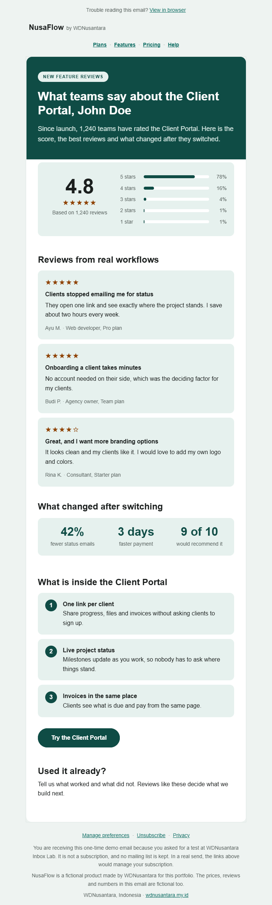
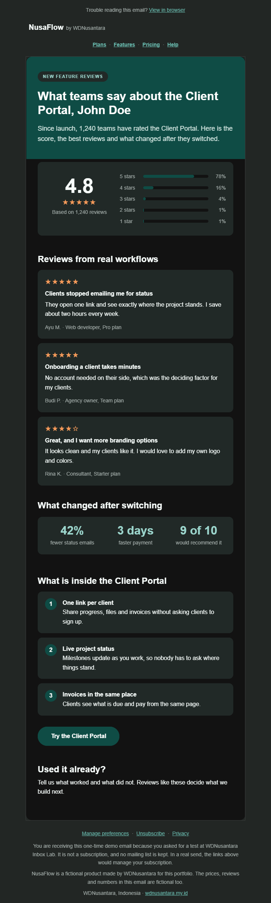
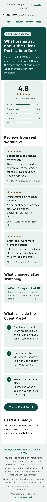

# Feature reviews: a social-proof email for a new feature

**Template id:** `feature-reviews` · **Brand:** NusaFlow (fictional) · **Type:** marketing email built on social proof

## The brief

NusaFlow launched a Client Portal and wants people to see how it landed. One email: the overall rating, the best reviews, what changed for teams that switched, what is inside the feature, and one way in. The reviews, the rating and the numbers are fictional.

## What is in it, top to bottom

1. A "View in browser" link, the wordmark and a navigation row.
2. A dark teal hero with a pill label and a headline that names the feature.
3. A rating summary: the score (4.8), a star row, the review count, and a bar for each star level with its percentage.
4. Three review cards, each with stars, a title, a short quote, the reviewer and their plan.
5. A row of three before-and-after numbers.
6. Three numbered tiles that say what is inside the feature.
7. One call to action, a short "used it already?" invitation, and a marketing footer.

## Decisions and why

- **The rating bars are table cells, not images.** Each bar is a cell whose width is the percentage, so it renders when images are blocked and scales with the layout. The percentage is also written as text, so the bar is never the only carrier of the number.
- **Stars are text glyphs with a real label.** The star rows are exposed as images with a label such as "4.8 out of 5 stars" or "5 out of 5 stars", so a screen reader does not read five symbols.
- **One review is four stars, with a mild complaint.** A wall of five-star reviews reads as fake. The third card asks for more branding options, which makes the set more believable.
- **The star color is tested.** It is a design token with its own contrast test: between 6.1 and 7.1 against the card, page and tile backgrounds in light, and between 7.4 and 9.2 in dark.
- **The key-numbers row from `plan-sale` is reused.** Same component, same phone fix: the numbers drop to 20 px under 480 px so they stay on one line.
- **No images in this version.** As in the other templates, everything is table cells, CSS and glyphs. Illustrations are a planned follow-up.

## What real inboxes showed

I sent the email from the live site and captured it in Gmail on the web (Chrome, Windows) and in the Gmail app on an Android phone (Tecno Pova 7 5G), in light and dark.

- **A typo that no test had caught.** My first captures showed the lowest rating bar labelled "1 stars". It was visible in every client. I wrote a failing test first, which reads the plain-text version and requires "1 star", then fixed the label, redeployed, and captured again. The proof here is from the corrected email.
- **Phones:** the rating bars, review cards and numbers hold up. The labels under the key numbers wrap onto three lines at this width ("fewer status emails"). They stay readable, and I left them as they are.
- **Dark mode:** like the other templates, the email renders correctly in dark. Gmail does its own color handling, so the buttons stay teal where Outlook.com's dark mode shows the amber ones I defined.

## Limits and what was not tested

- **Outlook.com:** my test emails were moved to Junk, so I have no Outlook capture of this template. I treat inbox placement on Outlook.com as unproven.
- **Apple Mail** and **Outlook for Windows (desktop):** not tested, so not claimed.

## Proof

All four screenshots are real client renders, taken on 6 October 2026.

| Client                               | Light                                                                                                   | Dark                                                                                                  |
| ------------------------------------ | ------------------------------------------------------------------------------------------------------- | ----------------------------------------------------------------------------------------------------- |
| Gmail on the web (Chrome, Windows)   |           |           |
| Gmail app, Android (Tecno Pova 7 5G) |  |  |
