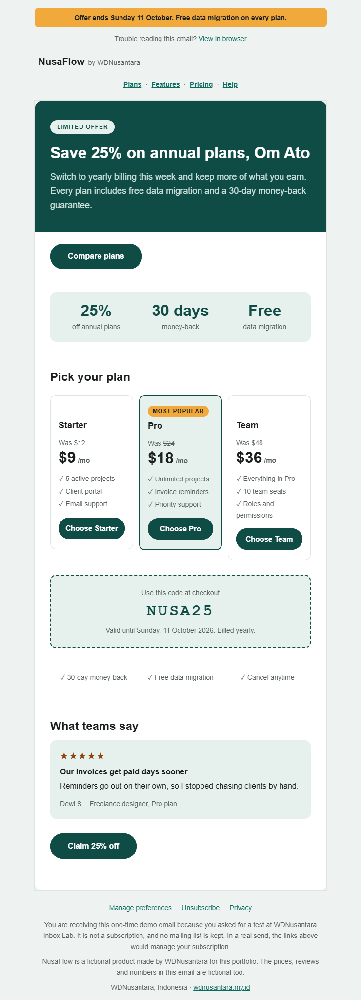
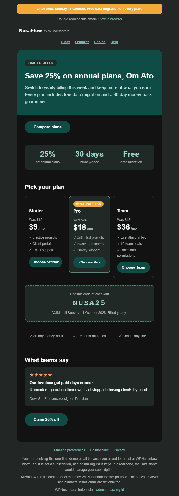
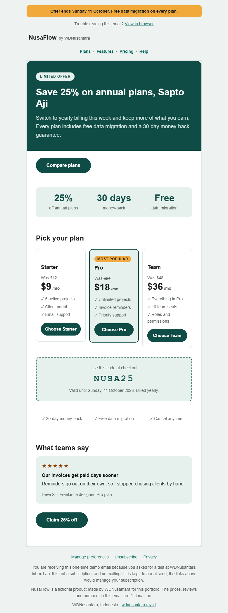
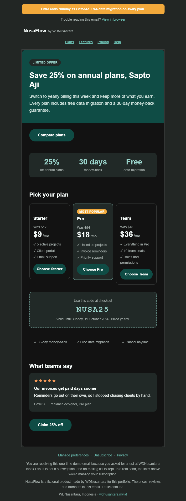
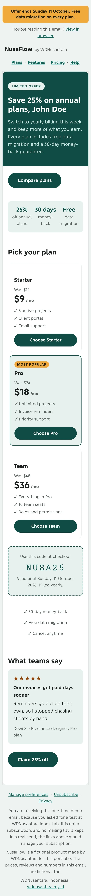
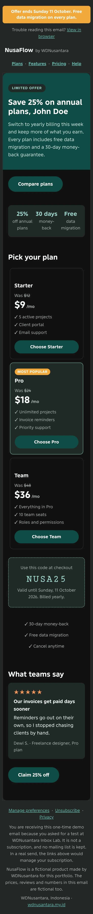

# Plan sale: a promotional email for annual plans

**Template id:** `plan-sale` · **Brand:** NusaFlow (fictional) · **Type:** promotional marketing email

## The brief

NusaFlow wants more customers on annual billing. One email, one offer: 25% off annual plans until Sunday 11 October 2026, with the code `NUSA25`. The reader should be able to compare three plans, see why the offer is low-risk, and click once. Prices, reviews and numbers are fictional.

## What is in it, top to bottom

1. An announcement bar with the deadline, and a "View in browser" link.
2. The wordmark and a navigation row.
3. A dark teal hero with a pill label, the offer as the headline, and a single call to action.
4. A row of three key numbers: 25% off, 30 days money-back, free data migration.
5. Three plan cards (Starter, Pro, Team). Each shows the old price struck through, the new price, three features and a button. Pro is highlighted as "Most popular".
6. A dashed promo-code box.
7. A trust row, one customer review, and a closing call to action.
8. A marketing footer with preferences, unsubscribe and privacy links, and a plain statement that this is a one-time demo.

## Decisions and why

- **No images in this version.** Everything is table cells, CSS and text glyphs, so nothing disappears when a client blocks images. The trade-off is less visual richness. Illustrations are a planned follow-up, with an image-size budget.
- **One destination.** Every button leads to the same place, the offer. The plan buttons are choices inside that one journey, not competing goals.
- **Prices that read without styling.** Each old price is written "Was $24" with a struck-through number, so the meaning survives for a screen reader or a client that drops the strikethrough.
- **The featured plan is not marked by color alone.** It has a "Most popular" badge and a thicker border.
- **Pill buttons with a fallback.** Buttons are 52 px pills. Outlook's desktop engine ignores rounded corners on links, so there is a matching VML version for it.
- **Stacking on phones.** Plan cards and the trust row become one column under 480 px. The key-numbers row stays three across, with smaller numbers.
- **Dark mode is designed, not inverted.** Tiles, borders, the label pill, the promo box and the star rating have their own dark colors, plus selectors for Outlook.com's dark mode.
- **Contrast is tested, not eyeballed.** Every text and background pair is checked at 4.5:1 or better in light and dark by an automated test over the design tokens. The star color measures between 6.1 and 7.1 in light and between 7.4 and 9.2 in dark, across the card, page and tile backgrounds.
- **A real marketing footer, with an honest note.** Preferences, unsubscribe and privacy links are there, because that is the standard. The footer also says this is a one-time demo and that no list is kept.

## What real inboxes showed

I sent the email from the live site and captured it in real clients.

- **Gmail on the web (Chrome, Windows):** rendered as designed in light and dark. Gmail applied the email's own dark colors.
- **Outlook.com in the browser:** rendered as designed in light and dark, including the rounded corners and pill buttons.
- **Gmail app on an Android phone (Tecno Pova 7 5G):** this found a real bug. In the key-numbers row, "30 days" broke onto two lines ("30" over "days") because each column is only about 90 px wide at 375 px. I wrote a failing test first: at 375 px, no big number may wrap. Then I made the numbers 20 px on phones. I re-sent the email and re-captured it, and the numbers now sit on one line.
- **A false alarm:** one Outlook.com light capture looked broken, with a duplicated promo box and a missing review title. It was a seam from stitching my own overlapping screenshots. I retook it as a single capture and the email was fine.

## Not tested

- **Apple Mail:** I don't have a device for it, so it is not claimed.
- **Outlook for Windows (desktop):** it uses a different rendering engine (Word). The VML button and conditional comments are in place, but I have not seen the result in a real client. The Outlook screenshots here are Outlook.com in a browser.

## Proof

All six screenshots below are real client renders, taken on 5 October 2026.

| Client                               | Light                                                                                       | Dark                                                                                      |
| ------------------------------------ | ------------------------------------------------------------------------------------------- | ----------------------------------------------------------------------------------------- |
| Gmail on the web (Chrome, Windows)   |           |           |
| Outlook.com in the browser           |       |       |
| Gmail app, Android (Tecno Pova 7 5G) |  |  |
